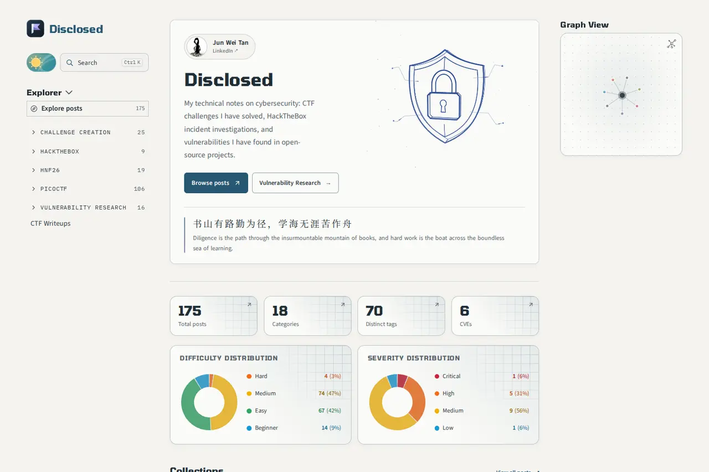
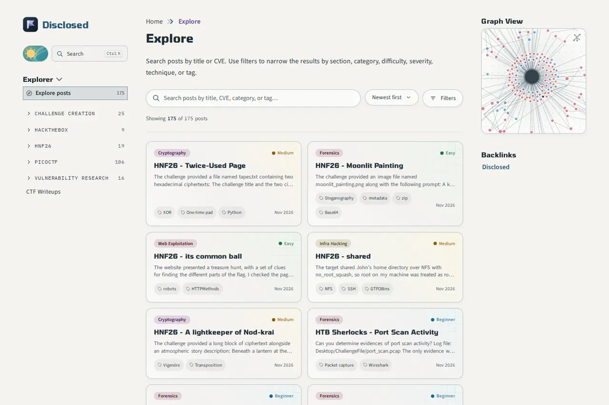

# Disclosed

[Disclosed](https://disclosed.nepz.dev/) is my cybersecurity blog. I write about CTF challenges I've solved and created, my HackTheBox Sherlocks investigations, and vulnerabilities I've found in open-source software.

## Browse the blog

- [Explore](https://disclosed.nepz.dev/Explore) searches all published posts and filters by section, category, difficulty, severity, technique, and tag.
- [CTF Writeups](https://disclosed.nepz.dev/CTF-Writeups) contains my picoCTF and HNF26 writeups.
- [HackTheBox Sherlocks](https://disclosed.nepz.dev/HackTheBox/HackTheBox-Sherlocks) covers my investigations from retired Sherlocks.
- [Self-Created](https://disclosed.nepz.dev/Challenge-Creation/CTF-Challenges-I've-Created) collects the challenges I've created and their solutions.
- [Vulnerability Research](https://disclosed.nepz.dev/Vulnerability-Research/Vulnerability-Research) documents the vulnerabilities I've reported, with links to advisories, CVE records, and fixes when available.

The homepage displays build-time post counts, difficulty and severity charts, and recent posts. The sidebar provides site-wide search and a theme switcher. The graph, backlinks, and table of contents help readers navigate related material.

## Publish a post

Write posts as Markdown in `content/<Section>/<Category>/`. Put linked media in `content/Assets/` and use `draft: true` to exclude a work in progress from the site.

- CTF writeups use a difficulty tag such as `easy`, `medium`, or `hard`.
- Research posts can use the [vulnerability writeup template](Templates/Vulnerability%20Writeup.md). The post header and overview use its advisory, CVE, CVSS, and remediation fields when provided.
- Add new sections to the [section registry](quartz/util/sections.ts) so they appear on the dashboard and in Explore. The [technique registry](quartz/util/techniques.ts) maps tags to technique filters.

For the displayed post date, set `date` in frontmatter. Quartz uses the file's first Git commit when that field is absent.

## License

The writing in `content/` is licensed under [CC BY-NC 4.0](https://creativecommons.org/licenses/by-nc/4.0/). The site code is built on [Quartz](https://github.com/jackyzha0/quartz) and is available under the [MIT License](LICENSE.txt).
