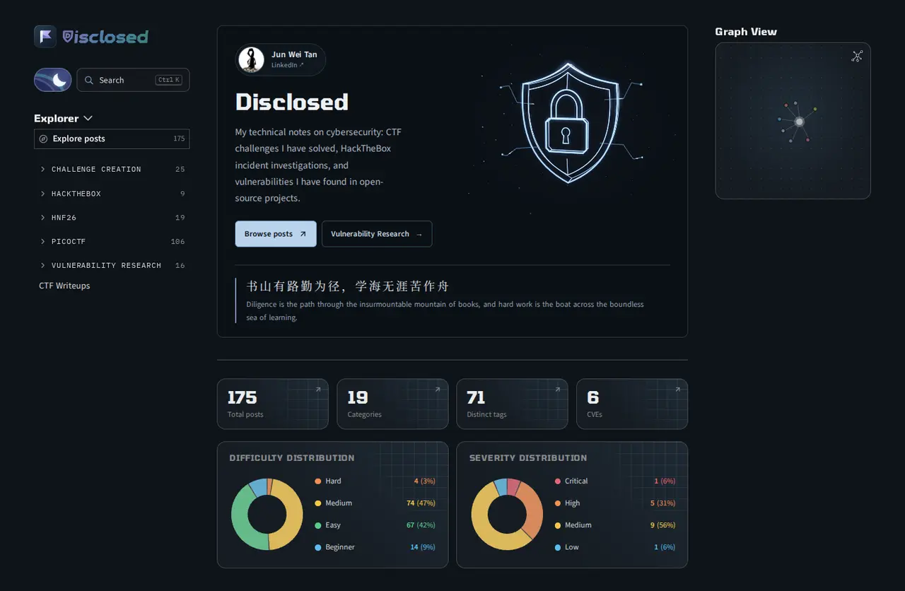
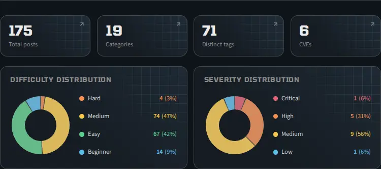
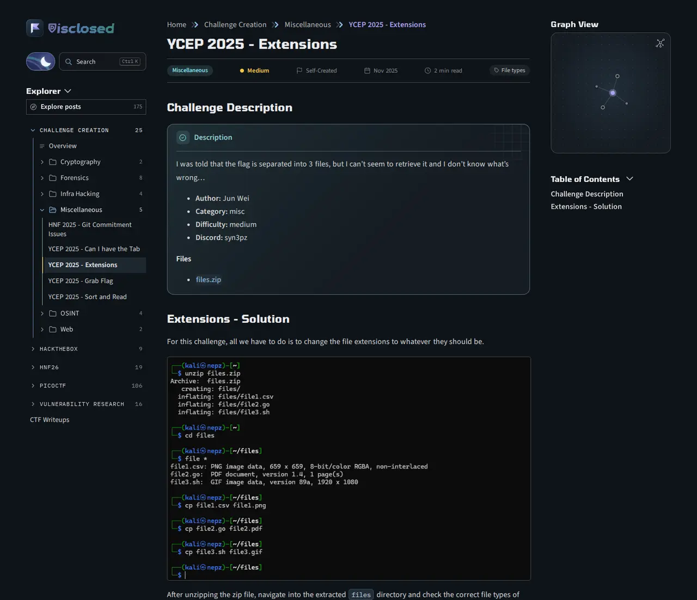
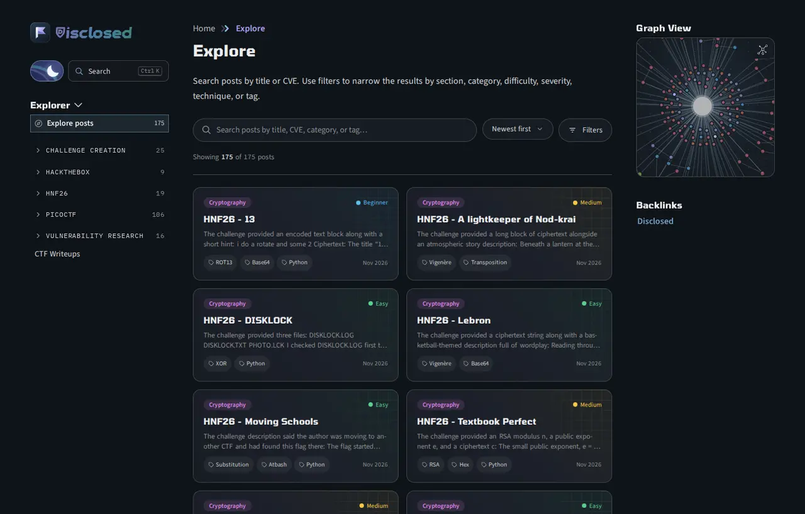
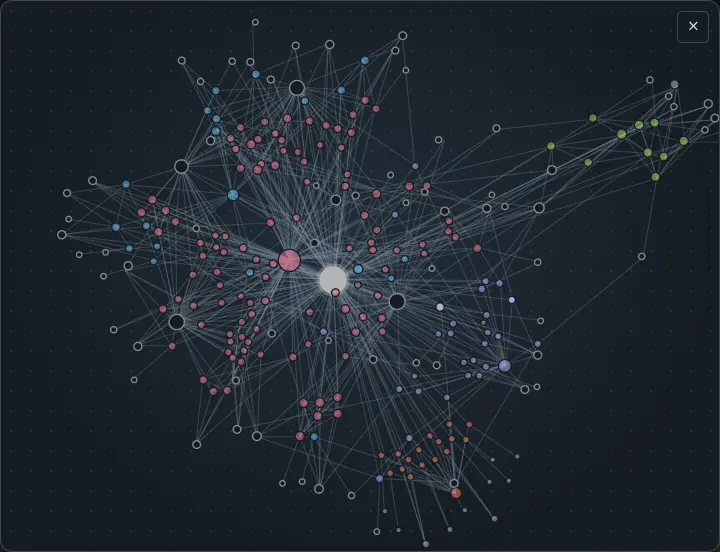

<h1 align="center">
  
</h1>

Welcome to my cybersecurity blog! Here you'll find writeups for CTF challenges I've tackled, investigations from HackTheBox Sherlocks, original challenges I've created, and vulnerabilities I've found in open-source software.

> Click &#9733; if you like this project! I really appreciate it!

## Contents

  
  <h4>Landing Page</h4>

- **Challenges** cover my picoCTF and HNF26 solves, organised by category. I explain how I approached each challenge, the tools I used, and what I learned.
  - I also document [original challenges I've created](https://disclosed.nepz.dev/Challenge-Creation/CTF-Challenges-I've-Created), along with their solutions.
- **HackTheBox Sherlocks** covers my investigations from retired Sherlocks, using evidence such as event logs, file system records, and packet captures.
- **Vulnerability research** covers open-source vulnerabilities I've reported. I explain what I found and link to advisories, CVE records, and fixes where available.
- **Relevant resources** are linked in my writeups where they help explain a concept, tool, or technique.

## Statistics Dashboard

  
  <h4>Statistics</h4>

The landing page features a dashboard that updates as I add new posts.

- **Quick overview** shows the total number of posts, categories, tags, and CVEs.
- **Difficulty distribution** shows how my challenge writeups break down by difficulty.
- **Severity distribution** shows how the vulnerabilities I've reported break down by severity.

## Challenge Writeups

  
  <h4>Challenge Example</h4>

My writeups cover the challenge description, my approach, and the solution. Each post shows its category, difficulty, and tags at the top. The **Table of Contents** links to sections so readers can jump to the part they need.

> [!IMPORTANT]
> The estimated reading time is shown at the top of each writeup.

## Explore Page

  
  <h4>Explore</h4>

The [Explore page](https://disclosed.nepz.dev/Explore) brings all my posts together in one searchable view.

- **Search** across titles, CVEs, categories, and tags.
- **Filter** by section, category, difficulty, severity, technique, or tag. You can combine filters.
- **Sort** by newest, oldest, name, or rating.

## Graph View Visualization

  
  <h4>Graph View</h4>

The **Graph View** shows the relationships between my posts, collections, and tags.

- **Circles** represent pages or tags. You can click one to browse the related material.
- **Lines** show the links between them.

## The Ongoing Journey

I'll keep adding writeups as I solve challenges, work through investigations, and report vulnerabilities. I also update older posts when I have something to add.

## Site Navigation

Visit [Disclosed](https://disclosed.nepz.dev/) to browse the blog.

### Navigation

#### picoCTF

- [All writeups](https://disclosed.nepz.dev/PicoCTF/PicoCTF-Writeups)
- [Forensics](https://disclosed.nepz.dev/PicoCTF/Forensics/)
- [Cryptography](https://disclosed.nepz.dev/PicoCTF/Cryptography/)
- [General Skills](https://disclosed.nepz.dev/PicoCTF/General-Skills/)

#### HNF26

- [All writeups](https://disclosed.nepz.dev/HNF26/HNF26-Writeups)

#### HackTheBox

- [Sherlocks investigations](https://disclosed.nepz.dev/HackTheBox/HackTheBox-Sherlocks)

#### Challenge Creation

- [CTF Challenges I've Created](https://disclosed.nepz.dev/Challenge-Creation/CTF-Challenges-I've-Created)

#### Vulnerability Research

- [Vulnerability research posts](https://disclosed.nepz.dev/Vulnerability-Research/Vulnerability-Research)

## License

My writing in `content/` is licensed under [CC BY-NC 4.0](https://creativecommons.org/licenses/by-nc/4.0/). The site code is built on [Quartz](https://github.com/jackyzha0/quartz) and is available under the [MIT License](LICENSE.txt).
